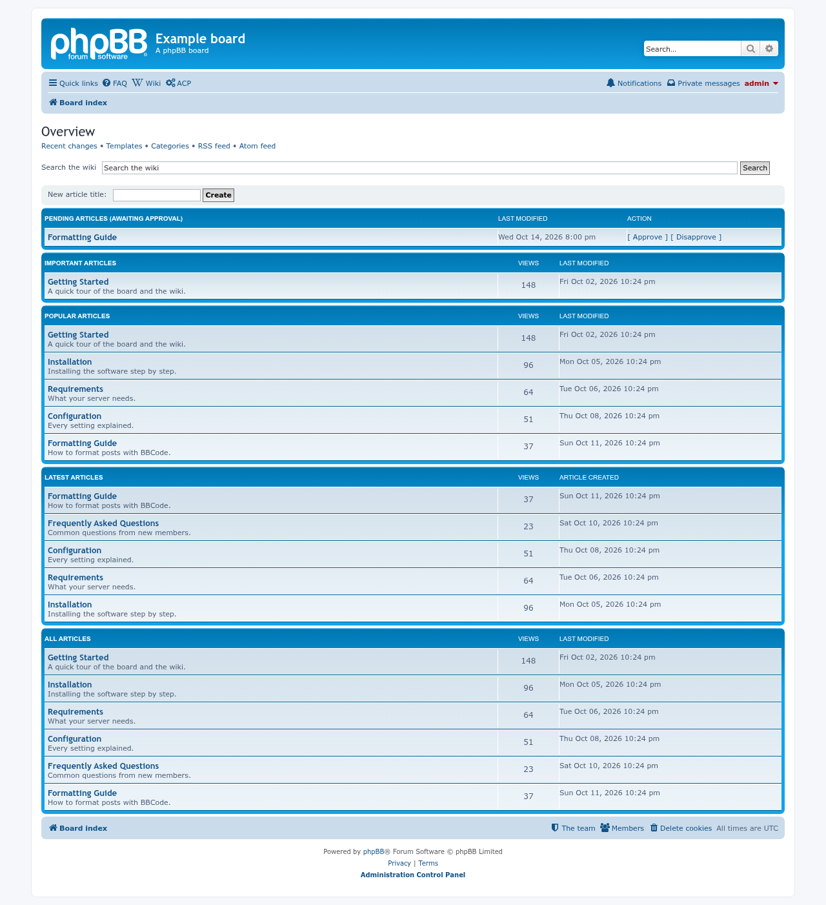
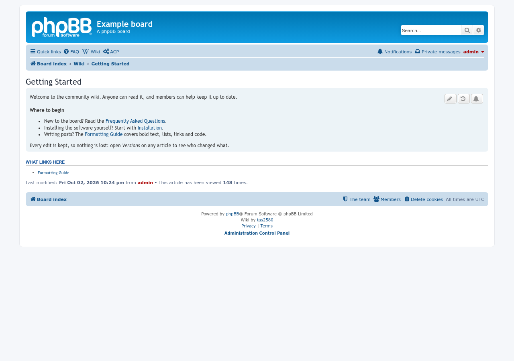
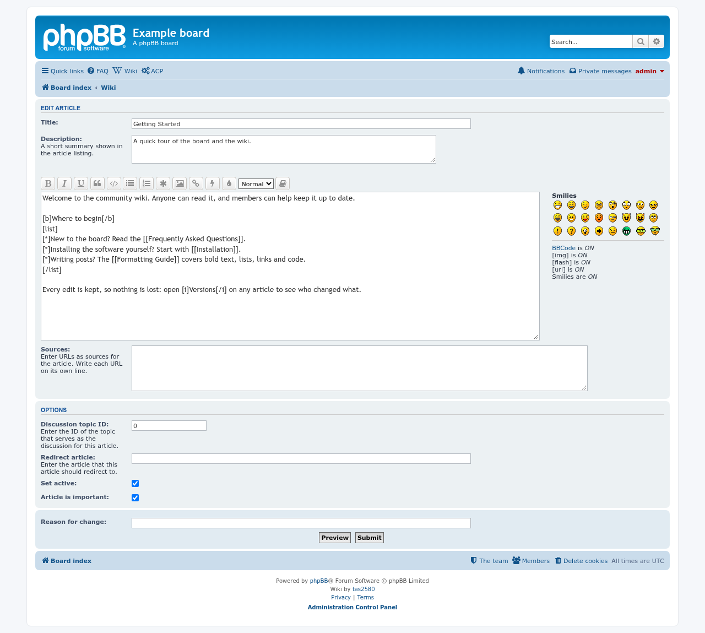
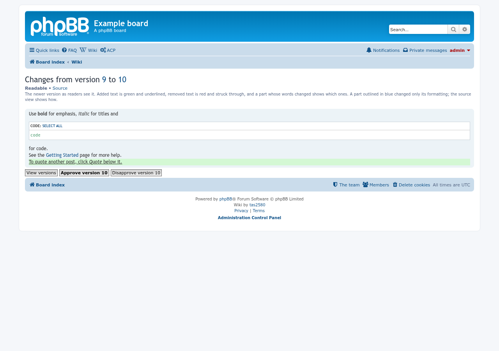
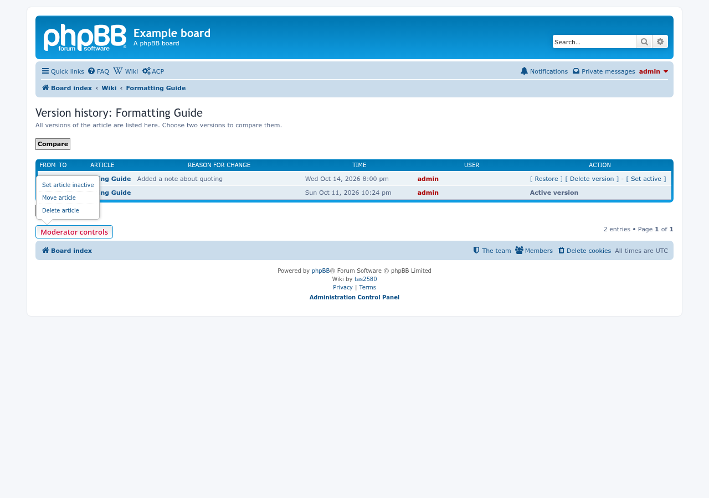
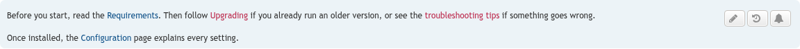
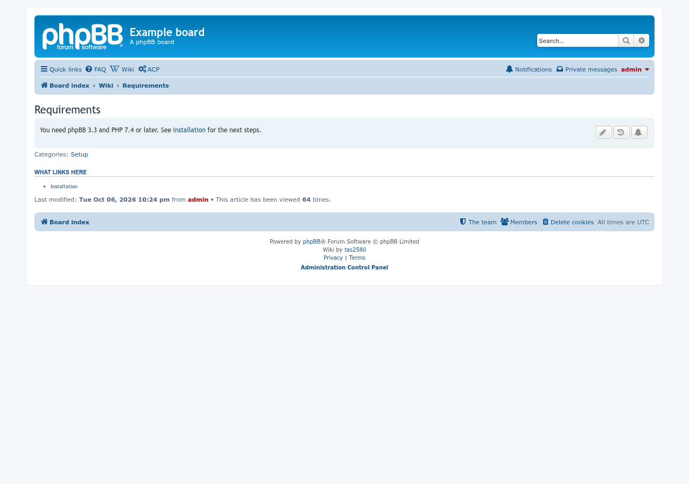

# phpBB Modders Wiki

[](https://github.com/phpbbmodders/phpbb-ext-wiki/actions/workflows/tests.yml) [](https://github.com/phpbbmodders/phpbb-ext-wiki/actions/workflows/lint.yml)

A wiki for phpBB with version history, side-by-side compare, and a moderation queue for edits.

## Features

- A wiki at `/wiki`, with an overview page listing its articles.
- Start an article from the overview page's **New article title** box, or by linking to `/wiki/<article-name>` and following the link.
- Link to another article by writing `[[Article name]]`, in articles and in forum posts; links to articles that don't exist yet are shown in red and open the editor. Each article lists the articles that link to it under **What links here**. See [Linking between articles](#linking-between-articles).
- Every edit is saved as a new version; compare any two versions. The compare page opens in a **Readable** view: the newer version as readers see it, with added text in green and underlined, removed text in red and struck through, and the changed words marked inside a line, list item or table row that changed. **Source** shows the BBCode diff. A `Template:` page is compared as written.
- **Restore** in the version history brings back an older version by saving its text, title, description, sources and redirect as a new version, so no version is lost. Members who may edit can restore; the restored version goes live straight away for members who may set versions active, and otherwise waits for approval like any edit.
- Edits can wait for approval: moderators get a **Pending articles** list with Approve and Disapprove. Approving a version older than the live one is blocked, so a stale draft can't overwrite newer content.
- Moderators can take an article offline or delete it, and articles can be made sticky or set to redirect.
- A **Recent changes** page at `/wiki/recent-changes` lists every version saved to the wiki that is or was live, newest first, with RSS and Atom feeds at `/wiki/recent-changes.rss` and `/wiki/recent-changes.atom` (the latest 50). The ACP setting **Recent changes feed** under **Extensions > Wiki > Settings** offers RSS, Atom or both, and the header advertises the offered feeds to feed readers. Versions waiting for approval never appear.
- A contributions page for every member, at `/wiki/contributions/<username>`, lists every version they saved across all articles, newest first. Author names on articles and in the version history link to it. Versions waiting for approval, and those of switched-off articles, show only to moderators and to the author.
- Files can be uploaded to an article by members who hold the **Can upload files to articles** permission. They are checked against the board's allowed file types and size limit, stored outside public view under `store/phpbbmodders_wiki/`, and read only through the wiki, which checks that the reader may see the article. In the text, `[[File:Diagram.png]]` shows an uploaded image and `[[File:notes.zip|the notes]]` links to any other file. The member who uploaded a file, or a moderator who may delete versions, can remove it, and deleting an article deletes its files.
- Notifications when an edit is waiting for approval.
- **Watch article** on every article page, for signed-in members: they are notified when a new version of a watched article goes live (a moderator approved an edit, or a trusted editor's edit went live directly), never about their own edit. It is a notification type in phpBB's notification settings, so members choose the bell, email or both. With the ACP setting **Watch edited articles** (on by default, under **Extensions > Wiki > Settings**), saving an edit also starts watching the article. Watches are removed with the article and with the member.
- Wikipedia-style headings: `== Heading ==` to `====== Heading ======` in an article become section headings with anchors, `[[Article#Section]]` and `[[#Section]]` link to them, and a table of contents shows after the intro when an article has four or more headings (`__TOC__` places it, `__FORCETOC__` forces it, `__NOTOC__` hides it). A first line `#REDIRECT [[Article]]` sets the redirect for members who may set redirects. This works in wiki articles only; in a forum post `== text ==` stays plain text.
- Tables, written as HTML in an article: `<table>`, `<caption>`, `<thead>`, `<tbody>`, `<tfoot>`, `<tr>`, `<th>` and `<td>`, with `colspan` and `rowspan` on a cell. BBCode and `[[links]]` work inside cells. Any other attribute (`style`, `onclick`, `class`) is dropped, and any other element (`script`, `iframe`) stays plain text. Like headings, tables work in wiki articles only; in a forum post `<table>` stays plain text. After upgrading, disable and enable the extension so the board rebuilds its cache.
- Templates: `{{Name}}`, `{{Name|first|second}}` and `{{Name|key=value}}` in an article include the live version of the article `Template:Name`, so a notice or infobox is written once and edited in one place. See [Templates](#templates).
- Categories: `[[Category:Name]]` in an article puts it in a category. The article lists its categories at the bottom, `/wiki/Category:Name` lists the articles in a category, and `/wiki/categories` lists every category. See [Categories](#categories).
- Search: `/wiki/search` and a search box on the overview find articles by their title, description and text, with highlighted snippets. It has its own index, kept current as articles are saved, approved, set offline and deleted, and three backends to choose from in the ACP (native, MySQL fulltext, PostgreSQL fulltext). The board's own search can show the matching articles in a block of their own, with an "Also search the Wiki" option. See [Search](#search).
- The Wiki link in the board header shows the Wikipedia icon by default. Under **Extensions > Wiki > Settings** in the ACP the icon can be changed to any [Font Awesome](https://fontawesome.com/v4.7.0/icons/) icon name, or left blank for no icon.
- A **Start discussion** button on each article creates its discussion topic in a forum chosen under **Extensions > Wiki > Settings** in the ACP, and links the topic to the article. It shows to members who hold the "Can change the discussion topic for an article" permission and may post in that forum, and stays hidden until a forum is chosen.
- Separate permissions for viewing, editing, version history, deleting and moderating.

## Screenshots

| Overview | Article |
|---|---|
| [](docs/images/wiki-overview.png) | [](docs/images/wiki-article-view.png) |

| Editing | Pending review |
|---|---|
| [](docs/images/wiki-edit.png) | [](docs/images/wiki-pending-articles.png) |

Approving or disapproving a pending edit shows a diff against the currently
active version:

[](docs/images/wiki-compare.png)

The version history page also has a "Moderator controls" dropdown for taking
an active article offline or deleting it entirely:

[](docs/images/wiki-moderator-controls.png)

## Templates

A template is an ordinary wiki article whose name starts with `Template:`, for example `Template:Out of date`, so it has versions, approval and permissions like any article. Write `{{Out of date}}` in another article and the live version of the template is shown at that place.

Inside the template, `{{{1}}}`, `{{{2}}}` stand for the parameters by position and `{{{reason}}}` for a named one. `{{{reason|no reason given}}}` gives a default for when the parameter is missing; `{{{reason|}}}` makes it empty.

```text
Template:Out of date
<noinclude>Shows a notice that an article is out of date.</noinclude>
[b]Out of date[/b]: {{{reason|no reason given}}}

An article
{{Out of date|reason=the 2.0 release changed this}}
```

- Parameters are `{{Name|value}}` by position (the first bare value is `{{{1}}}`) or `{{Name|key=value}}`; a bar inside a `[[link|text]]` or another template belongs to that.
- What is inside `<noinclude>` is left out when the template is included, and `<includeonly>` text is included without the tags, so a template page can carry its own documentation.
- The template is looked up when the article is shown, so editing it changes every article that uses it. Only a template's approved version is used.
- A template can give table rows or cells (a text that starts with `<tr>`, `<tbody>`, `<td>` and so on), to be called between the `<table>` tags of an article: `<table>{{Row|a|1}}{{Row|b|2}}</table>`.
- Limits, so one article cannot slow the board down: at most 500 template calls written in an article, 2000 calls and functions in all (including those inside templates), and about 500,000 characters of output. Past a limit the rest of the calls show "Too many templates" where they stand.
- A template can include other templates, ten levels deep at most; a template that includes itself, directly or through another template, shows an error where the loop is (it cannot stop its own recursion with `{{#if:}}`, as on Wikipedia). A call to a template that does not exist is a red link to `Template:Name`.
- The text of a template is parsed like article text, so it can use BBCode, `[[links]]`, headings and tables, and nothing an article could not.
- The page of a template shows its documentation (what is inside `<noinclude>`, with its calls worked out, so it can show examples), then **Template text**: the text an article gets, as it is written and not worked out, with how many articles use it. `<includeonly>` text is left off the page. **What links here** lists the articles that use the template.
- **Templates** at `/wiki/templates`, linked from the overview, lists every template A to Z with its short description (the article's description field), how many articles use it, and when it was last edited. A **How to use templates** box above the list explains `{{Name}}`, values and the Start templates, plus, for members who can edit, how to make one. Under each template, **Preview and how to write it** opens the call to write, with a placeholder for each value it takes, and its documentation as a preview. Templates are left out of the overview's article lists.
- **Start from a template.** A template whose name starts with `Start ` (for example `Template:Start Extension`) is offered when someone creates a new article: a **Start from** choice above the edit form lists them by the rest of the name, and **Use** fills the text box with the template's text (without its `<noinclude>` parts) to edit and save as the new article. The choice appears only for an article that does not exist yet, and only when at least one such template exists. Nothing is included: the text is copied, so later edits to the template do not change articles made from it.
- Like headings and tables, this works in wiki articles only; in a forum post `{{Name}}` stays plain text. The first letter of a template name is not case-sensitive (`{{out of date}}` finds `Template:Out of date`).
- **Parser functions** decide what a template shows. Only the part that is chosen is worked out, so the branch that is not taken can hold anything.

  | Call | Result |
  |---|---|
  | `{{#if: test \| then \| else}}` | `then` when `test` is not empty, otherwise `else` |
  | `{{#ifeq: a \| b \| same \| different}}` | compares as numbers when both are numbers, otherwise as text |
  | `{{#switch: value \| a = one \| b = two \| #default = other}}` | the result of the matching case; a case without `=` falls through to the next, and a last bare value is the default |
  | `{{#ifexist: Article \| yes \| no}}` | whether the article has an approved version |
  | `{{#expr: (2 + 3) * 4}}` and `{{#ifexpr: 3 > 2 \| yes \| no}}` | arithmetic: `+ - * / div mod ^ round`, comparisons, `and or not`, brackets, and `abs ceil floor trunc sqrt exp ln sin cos tan`, `e` and `pi` |
  | `{{lc:Text}}`, `{{uc:Text}}`, `{{lcfirst:Text}}`, `{{ucfirst:Text}}` | lower and upper case |
  | `{{PAGENAME}}`, `{{FULLPAGENAME}}`, `{{NAMESPACE}}` | the article being shown (`Template:Name` has the namespace `Template`) |
  | `{{SITENAME}}` | the board's name |
  | `{{#iferror: test \| error \| ok}}` | `error` when `test` is one of the red messages below (a failed `#expr`, a template loop, an unknown function), otherwise `ok`, or `test` itself when `ok` is left out |
  | `{{#time: j F Y, H:i \| date}}` | a date in a format, in UTC: `Y y n m M F d j D l N w z W t L H G h g i s a A U c r e` as in PHP's `date()`, `"quoted text"` and `\c` as written; `date` is anything PHP reads (`2026-10-12`, `@1791500000`, `yesterday`, `+1 week`), and the time now when left out |
  | `{{CURRENTYEAR}}`, `{{CURRENTMONTH}}`, `{{CURRENTMONTHNAME}}`, `{{CURRENTMONTHABBREV}}`, `{{CURRENTDAY}}`, `{{CURRENTDAY2}}`, `{{CURRENTDAYNAME}}`, `{{CURRENTDOW}}`, `{{CURRENTWEEK}}`, `{{CURRENTHOUR}}`, `{{CURRENTTIME}}`, `{{CURRENTTIMESTAMP}}` | the date and time now, in UTC, with English month and day names |
  | `{{#len: text}}` | the number of characters |
  | `{{#pos: text \| find \| from}}`, `{{#rpos: text \| find}}` | where `find` first or last occurs, counted from 0; `#pos` gives nothing and `#rpos` gives `-1` when it is not there |
  | `{{#sub: text \| start \| length}}` | part of `text`; a negative `start` counts from the end and a negative `length` leaves that many off the end |
  | `{{#replace: text \| find \| with}}` | every `find` swapped for `with` |
  | `{{#explode: text \| separator \| position \| limit}}` | one piece of `text` cut at `separator`, counted from 0 (negative from the end) |
  | `{{padleft: text \| length \| fill}}`, `{{padright: text \| length \| fill}}` | `text` filled up to `length` with `fill` (default `0`) |
  | `{{urlencode: text}}`, `{{anchorencode: text}}` | `text` as a web address part, and as a heading anchor |

  A call that cannot be worked out, such as `{{#expr: 1/0}}`, shows a red message where it stands. An unknown `{{#function:}}` does too.

  The arguments of a function are trimmed of spaces and line breaks before it works on them.
- After upgrading, disable and enable the extension so the board rebuilds its cache. Articles saved earlier hold `{{...}}` as plain text until they are saved again or reparsed with `php bin/phpbbcli.php reparser:reparse phpbbmodders_wiki_article`.

## Categories

Write `[[Category:Name]]` anywhere in a wiki article to put it in a category. The mark shows nothing in the text; the article lists its categories at the bottom, each linking to the category's page.

- `[[Category:boxes]]` and `[[Category:Boxes]]` are the same category: the first letter is capitalised and underscores count as spaces. A sort key after a bar (`[[Category:Boxes|key]]`) is accepted and ignored.
- **A category page** is the article `Category:Name`, at `/wiki/Category:Name`. If nobody wrote it, the page still exists as a list of the articles in the category, A to Z with their descriptions, with a link to write a description. If an article called `Category:Name` exists, its text is shown above the list, and it has the usual edit and version buttons.
- **`/wiki/categories`** lists every category with a live article in it, how many, and its description (the description field of its `Category:Name` article), linked from the overview. A **How to use categories** box above the list explains `[[Category:Name]]` and category pages, plus, for members who can edit, how to describe a category. Under each category, **Articles in it and how to add one** opens the line to write and its first five articles. Category pages are left out of the overview's article lists.
- Only the live version of an article counts. A forum post keeps `[[Category:Name]]` as plain text, like the rest of the wiki markup.
- A template page counts for the categories it names outside `<includeonly>`, so `<noinclude>[[Category:Infobox templates]]</noinclude>` puts the template in that category. A category added inside `<includeonly>` by a template shows under the articles that use the template, but those articles are not in the category's list, which is found from the articles' own text.
- After upgrading, disable and enable the extension so the board rebuilds its cache. Articles saved before this build keep `[[Category:Name]]` as text until they are saved again or reparsed with `php bin/phpbbcli.php reparser:reparse phpbbmodders_wiki_article`.

## Search

The wiki has its own search, separate from phpBB's search of posts: **Search the wiki** on the overview, or `/wiki/search?keywords=...`.

- It searches the live version of each article: its title, its description and its text, with the markup (BBCode, links, templates, tables, categories) reduced to the words in it. Older versions and edits waiting for approval are not searched. Template and category pages are articles too, so they are found.
- Choose to match all the words or any of them, to search titles only or text only, and to sort by last edit or title. Results show the title, description, a snippet with the words marked, and the date.
- It follows the articles: saving a live article, approving a version, setting an article offline, putting it back and deleting it all update the search at once.
- The search needs the permission to read the wiki and phpBB's own "Can use search" permission, and it is off when the board's search is off.

**In the board's search.** A search for words in phpBB's own search, or from the search box in the header, also looks in the wiki. The matching articles are shown in a **Wiki (N)** block above the forum results, with the title, description, a snippet and a link to all of the matches; the forum results themselves are not changed. The advanced search has an **Also search the Wiki** option, ticked by default, to leave the wiki out. The block shows only on the first page of the results, only for members who may read the wiki, and not for searches by author, within one topic, or the pre-made ones such as active topics.

**In the ACP**, under **Extensions > Wiki > Search**, switch the wiki search on or off, set the results per page, switch the board search block on or off and set how many articles it lists, and choose the backend:

| Backend | For | Notes |
| --- | --- | --- |
| Native | Every database, including SQLite | Keeps its own word tables. Words in most articles are treated as common once a wiki has 100 articles or more, as in phpBB's own search |
| MySQL fulltext | MySQL | Adds fulltext indexes to the search's text table |
| PostgreSQL fulltext | PostgreSQL | Adds text-search indexes to the search's text table |

All three backends are listed; the ones the database cannot run are marked as unavailable and cannot be chosen. After installing, or after switching backend, press **Create index** under **Search index** for the backend you chose; until then the native backend finds only articles saved since it was installed, and the fulltext backends find nothing. The page shows each index's statistics and can delete it.

The search keeps a plain-text copy of each live article in its own table (`wiki_search_text`); **Create index** makes that copy again from the articles before it builds the backend's index, so it is also the way to rebuild everything.

## Linking between articles

Write an article's name in double square brackets to link to it, in wiki articles and in forum posts:

- `[[Installation]]` links to the article **Installation**.
- `[[Installation|how to install]]` links to the same article but shows *how to install*.

Links to articles that don't exist yet are shown in red, and following one opens the editor to create that article. The **Wiki link** button in the editor toolbar inserts the brackets. Inside a `[code]` block the brackets stay plain text.

Below each article, **What links here** lists the other articles whose current version links to it.

<table>
  <tr>
    <td align="center"><a href="docs/images/wiki-article-links.png"></a><br>Links, with missing articles in red</td>
    <td align="center"><a href="docs/images/wiki-what-links-here.png"></a><br>What links here</td>
    <td align="center"><a href="docs/images/wiki-link-button.png"></a><br>The editor button (outlined)</td>
  </tr>
</table>

Articles and posts written before this feature existed get their links the next time they are edited. To convert them all at once, run phpBB's reparser from the board's folder: `php bin/phpbbcli.php reparser:reparse phpbbmodders_wiki_article` for articles and `php bin/phpbbcli.php reparser:reparse post_text` for forum posts.

## Requirements

- phpBB 3.3.19 or later (also tested on phpBB 4.0)
- PHP 8.2 or later

Tested versions and compatibility notes: [docs/compatibility.md](docs/compatibility.md).

## Installation

1. Copy the extension to `/ext/phpbbmodders/wiki`
2. In the Administration Control Panel, go to **Customise → Manage extensions**
3. Enable the **phpBB Modders Wiki** extension
4. Set who can view and edit the wiki under the usual Permissions screens

### Upgrading from `tas2580/wiki`

This extension used to be installed as `tas2580/wiki`. It is now
`phpbbmodders/wiki`. To switch an existing board without losing any
articles, versions, permissions or notification settings:

1. Disable the old **tas2580 Wiki** extension in the ACP. Do **not** delete its data.
2. Delete the `/ext/tas2580/wiki` folder.
3. Upload this version to `/ext/phpbbmodders/wiki` and enable it. The old
   install's migration history, notification type and users' notification
   settings are moved to the new name automatically; the wiki tables
   themselves never included the old name, so they are used as they are.
4. Purge the board cache.

If you disable the old extension from the command line (`bin/phpbbcli.php`)
instead of the ACP, run `bin/phpbbcli.php cache:purge` before enabling the
new one; the command-line disable doesn't clear the cache.

## TODO

Ideas not yet built, practical and speculative alike: [`docs/TODO.md`](docs/TODO.md).

## Contributing

Contributions are welcome!

- **Bug reports**: [Open an issue](https://github.com/phpbbmodders/phpbb-ext-wiki/issues).
- **Everything else** (questions, feature requests, ideas, general discussion): [Use Discussions](https://github.com/orgs/phpbbmodders/discussions), or the [community forum](https://www.phpbbmodders.com/community/).
- Pull requests are welcome for bug fixes or discussed features.

## Acknowledgments

- Original extension by [tas2580](https://tas2580.net).
- Updated for phpBB 3.2.x (notification API fixes, textreparser support) by
  Christian Schnegelberger ([Crizz0](https://www.crizzo.de)) in the
  [phpBB.de fork](https://github.com/phpbb-de/wiki).
- This fork builds on Crizz0's phpBB.de branch: fixed phpBB 3.3.x/4.0
  compatibility (routing, YAML parsing, notification API, Flash BBCode
  removal), completed missing English translations, added an approve/disapprove
  moderation queue for pending articles, and general bug fixes.
- Code review, bug fixes, and documentation assisted by [Claude](https://www.anthropic.com/claude).

## License

This extension is licensed under the **GNU General Public License v2.0**.

See [license.txt](license.txt) for more information.
