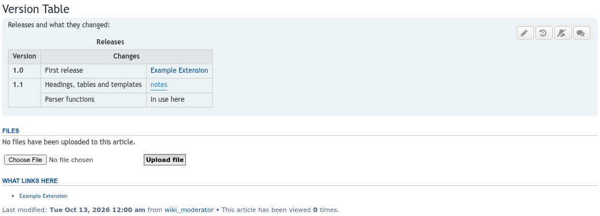
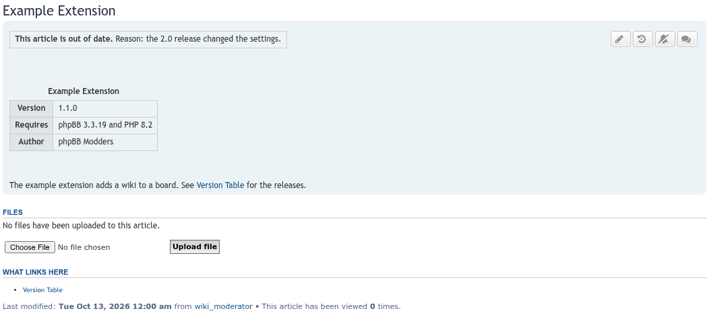
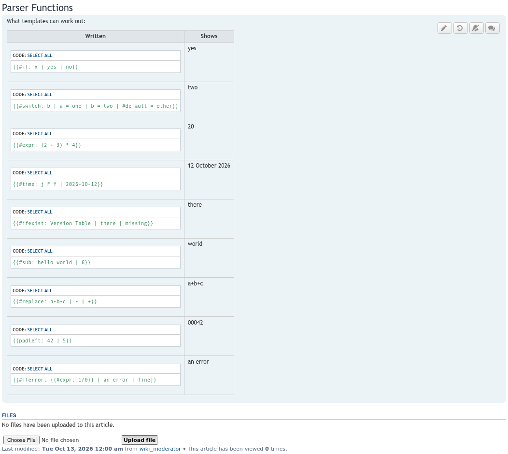

# Wiki update screenshots, 2026-10-12

Taken with Playwright on a throwaway phpBB 3.3.19 board (prosilver, MySQL 8.0), filled by `seed-wiki-fixtures.php` from seed-forum.

## Headings and contents

An article with headings, the contents box, and `[[Article#Section]]` and `[[#Section]]` links.

## File uploads

An uploaded diagram embedded with `[[File:name.png]]`.

## Watch and discussion buttons

The article header: edit, history, watch (bell) and discussion.

## Recent changes

Every saved version, with RSS and Atom feed links.

## Contributions

A member's saved versions.

## Overview

The overview page with pending articles, as a moderator sees it.

## ACP settings

ACP > Extensions > Wiki > Settings.

## Tables

A table written as HTML in an article, with a caption, a `colspan` header, a `rowspan` cell, BBCode and a link in the cells.

## Templates

An article that uses two templates: a notice (`{{Out of date|reason=...}}`) and an infobox (`{{Extension infobox|name=...|version=...}}`) whose rows appear only when a value is given. The template pages are `Template:Out of date` and `Template:Extension infobox`, and each lists the articles that use it under **What links here**.

## Parser functions

Each row shows a call, written in a `[code]` block, and what the wiki makes of it: `#if`, `#switch`, `#expr`, `#time`, `#ifexist`, `#sub`, `#replace`, `padleft` and `#iferror`.

