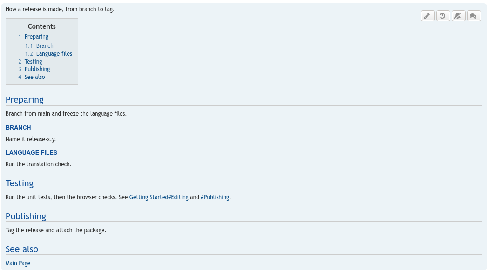
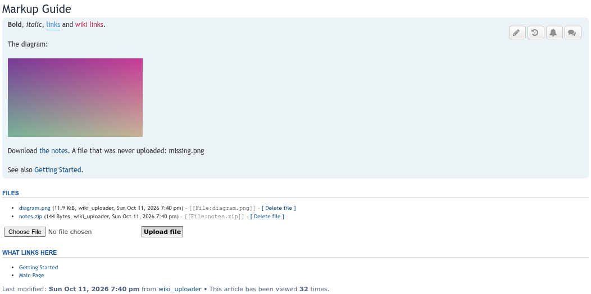
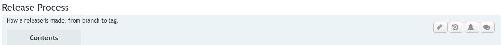
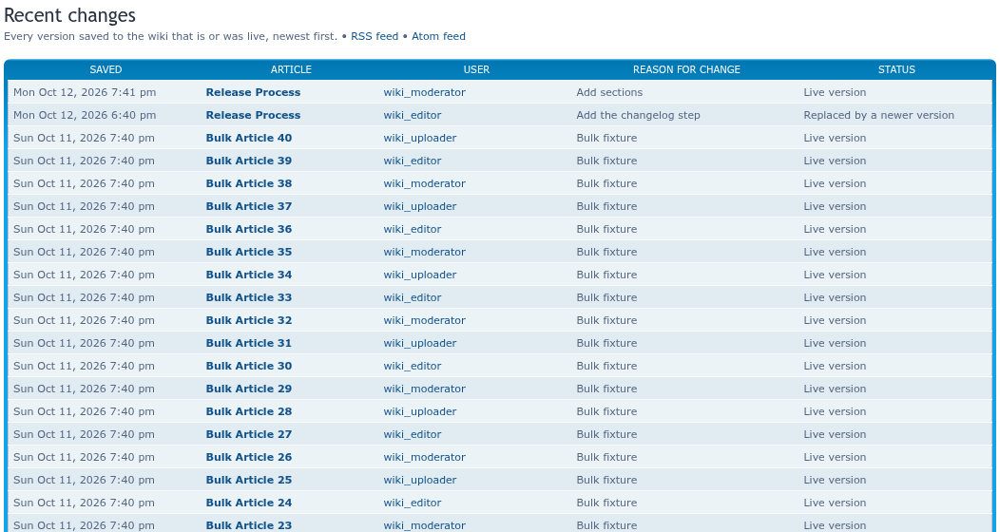
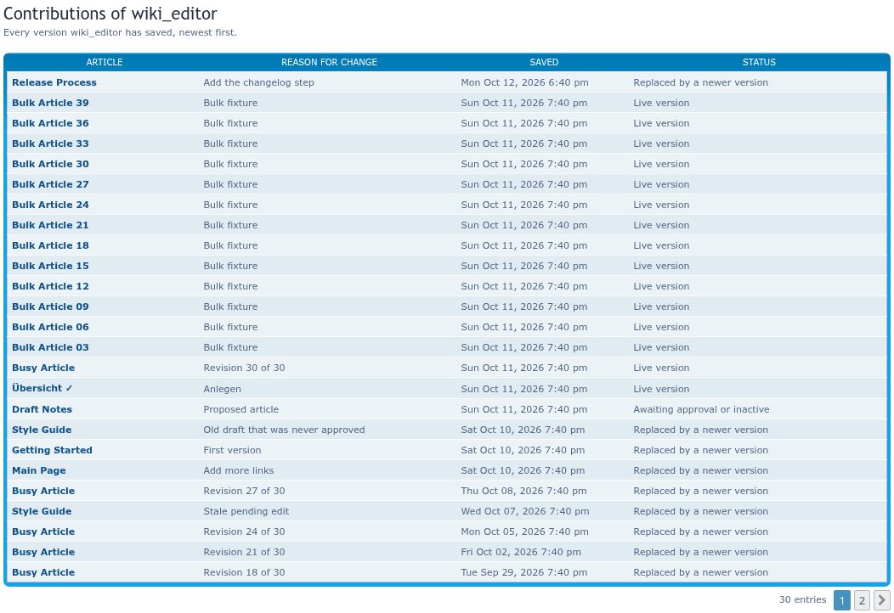
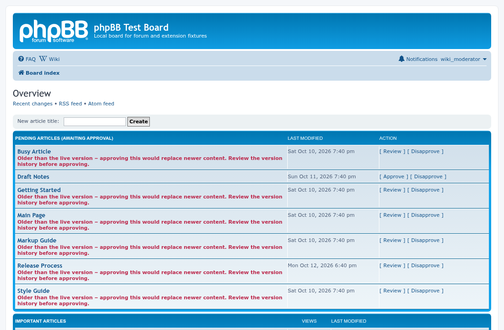
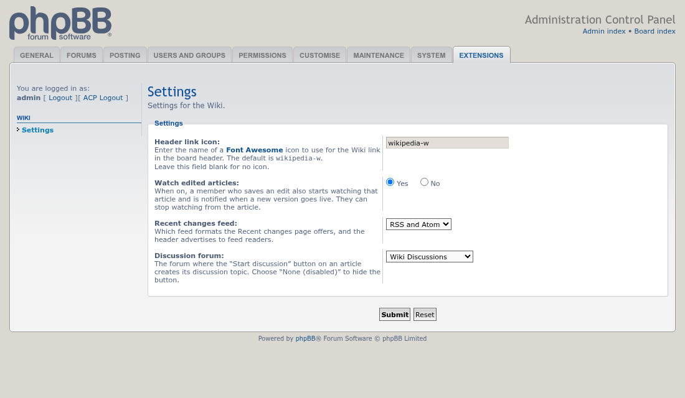

# Wiki update screenshots, 2026-10-12

Taken with Playwright on a throwaway phpBB 3.3.19 board (prosilver, MySQL 8.0), filled by `seed-wiki-fixtures.php` from seed-forum.

## Headings and contents

An article with headings, the contents box, and `[[Article#Section]]` and `[[#Section]]` links.

## File uploads

An uploaded diagram embedded with `[[File:name.png]]`.

## Watch and discussion buttons

The article header: edit, history, watch (bell) and discussion.

## Recent changes

Every saved version, with RSS and Atom feed links.

## Contributions

A member's saved versions.

## Overview

The overview page with pending articles, as a moderator sees it.

## ACP settings

ACP > Extensions > Wiki > Settings.

