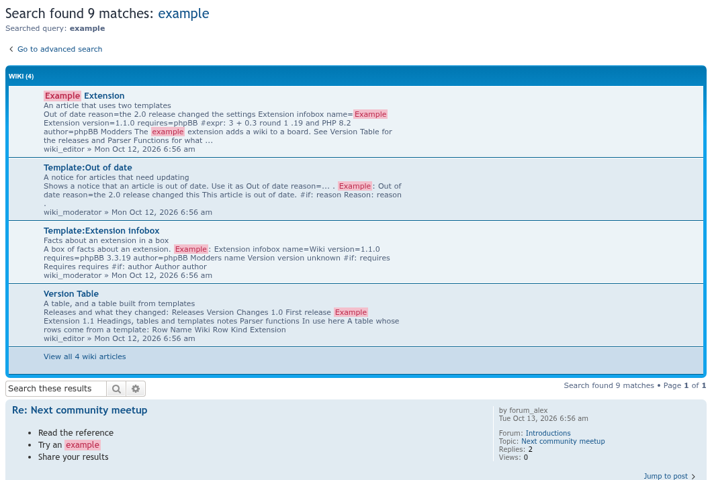
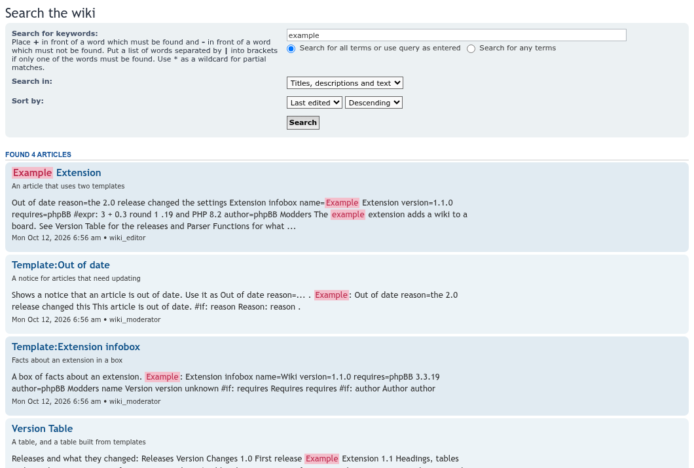
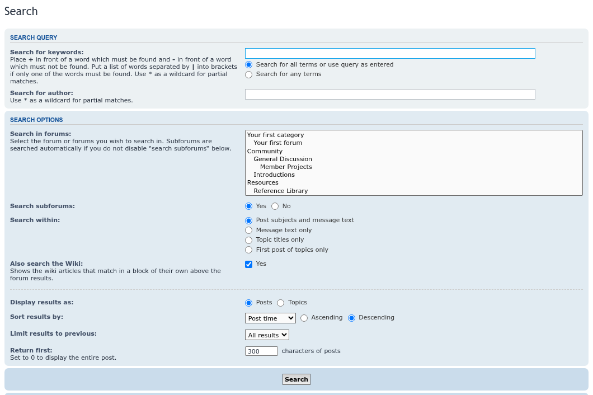
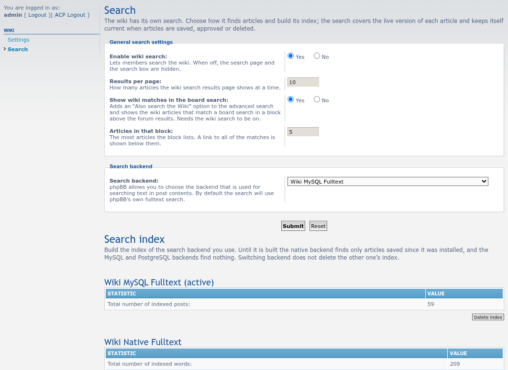
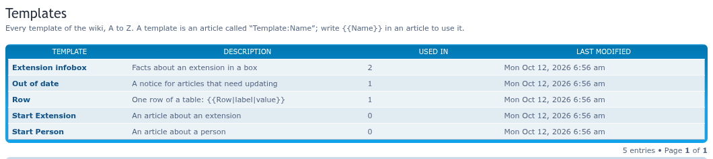
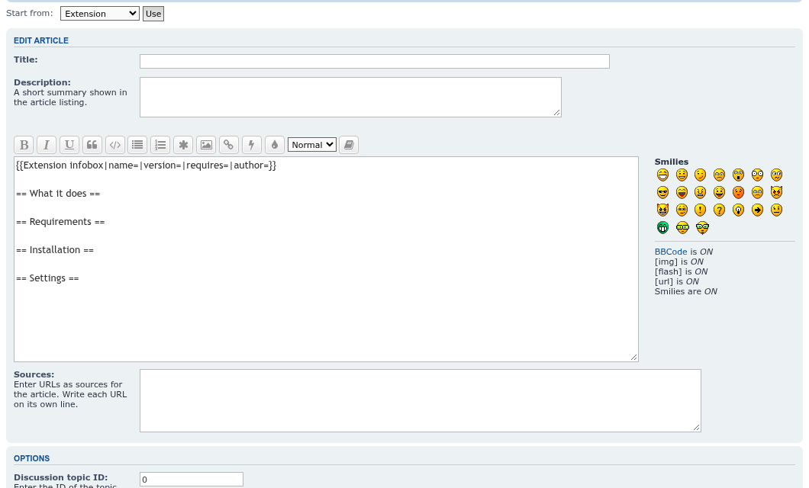
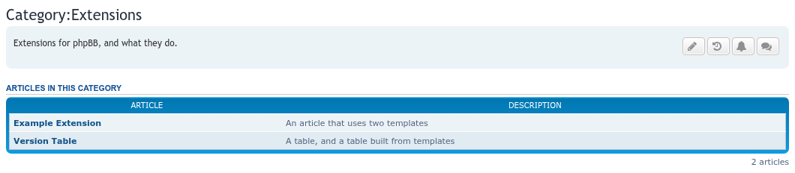
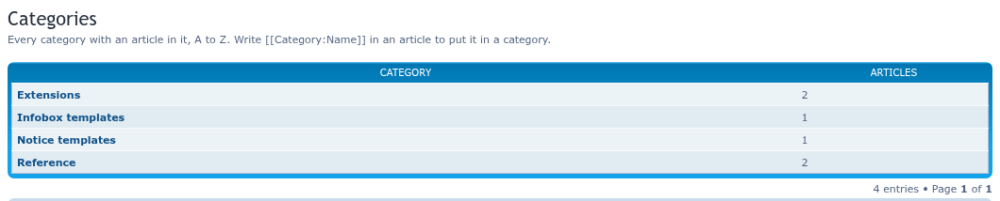

# Wiki update screenshots, 2026-10-13

Taken with Playwright on a throwaway phpBB 3.3.19 board (prosilver, MySQL 8.0), filled by `seed-wiki-fixtures.php` from seed-forum.

## Wiki matches in the board search

A search for `example` in phpBB's own search: the **Wiki (4)** block above the forum results, with a link to all of the matches. The forum results below are the board's own.

## The wiki's own search

`/wiki/search`: match all or any words, search titles only or text only, sort by last edit or title. Results show the title, description, a snippet with the words marked, and the date.

## Also search the Wiki

The advanced search has an **Also search the Wiki** option, ticked by default.

## ACP search settings

ACP > Extensions > Wiki > Search: switch the wiki search on or off, results per page, whether the board search shows the wiki block and how many articles it lists, the backend, and each backend's index.

## Templates

`/wiki/templates` lists every template with its description, how many articles use it, and when it was last edited.

## Start from a template

On a new article, **Start from** offers the templates whose name starts with `Start `; **Use** fills the text box with the template's text.

## Category page

`/wiki/Category:Extensions`: the category's description and the articles in it.

## Categories

`/wiki/categories` lists every category with the number of articles in it.

