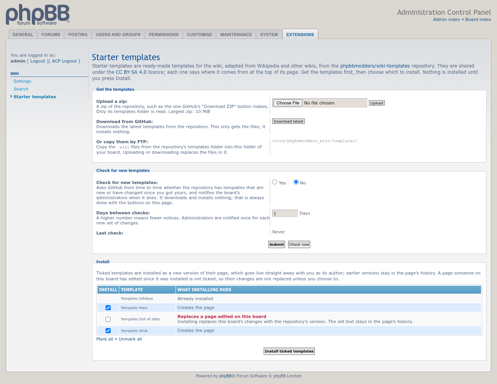
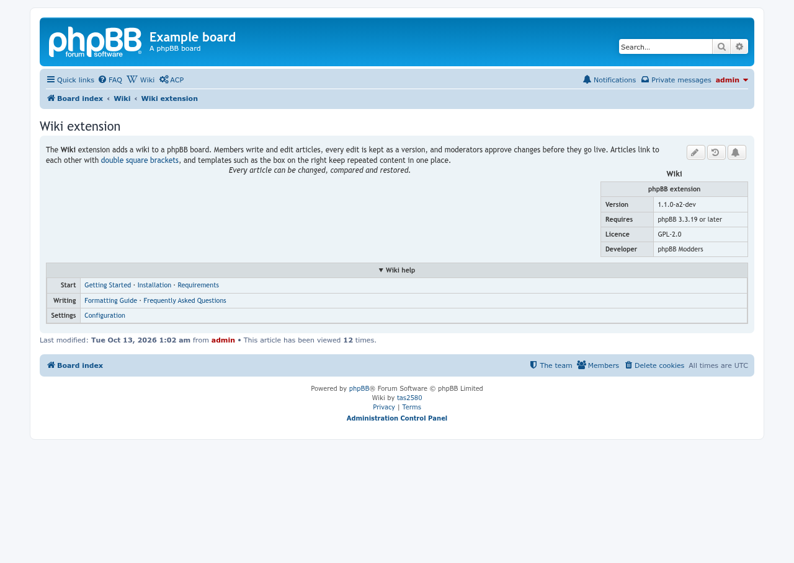
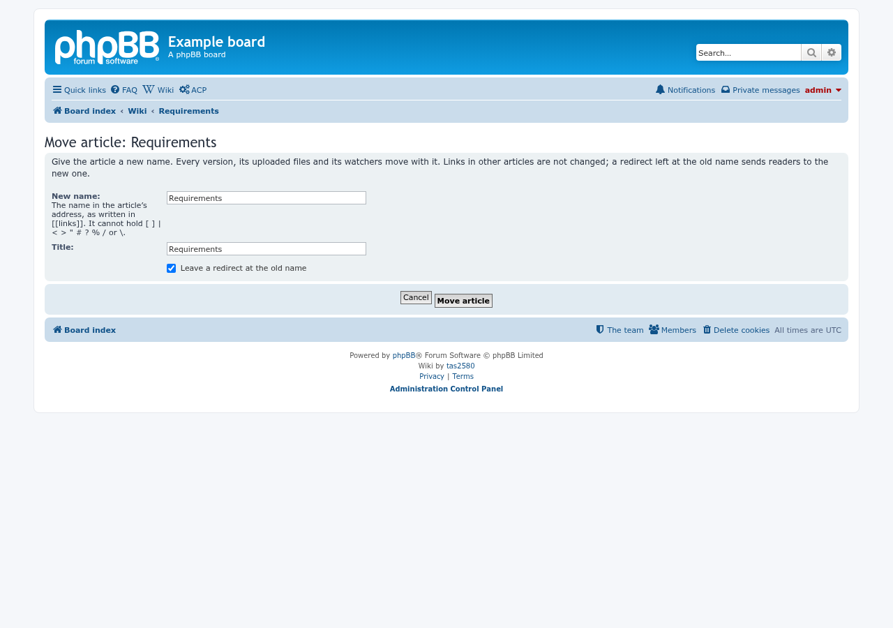
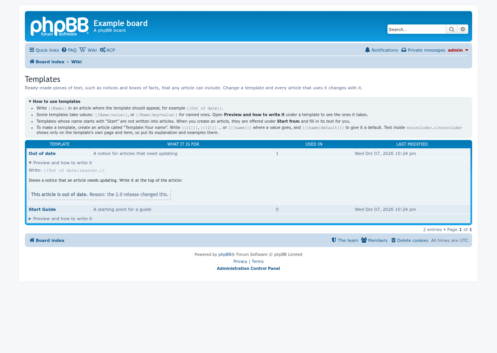

# Wiki update screenshots, 2026-10-14

Taken with `phpbb-test-board/screenshots.py` (phpbbmodders/phpbb-release-tools) on a throwaway phpBB 3.3.19 board (prosilver, SQLite). The images are in [`docs/images/`](../../images/), shared with the README and the Screenshots wiki page.

## Starter templates

ACP > Extensions > Wiki > Starter templates: get the templates of [phpbbmodders/wiki-templates](https://github.com/phpbbmodders/wiki-templates) (upload its zip, download it from GitHub, or copy the files by FTP), choose which to install, and optionally be told when the repository has new ones. A template the board already has, and one whose page was edited on the board, are listed but not ticked.

## Infobox, navbox and centred text

An article with `{{Infobox}}` floating at the right, a line in `
`, and `{{Navbox}}`, a box of links the reader can close with its title bar. Plain `

…
…
` makes a box the reader opens, for spoilers.

## Comparing versions

The compare page opens in a readable view: the newer version as readers see it, with added text in green and removed text struck through. **Source** shows the BBCode diff.

## Restore and move

The version history has a **Restore** link on every older version, and **Move article** in the moderator controls gives an article a new name, leaving a redirect at the old one.

## Templates and categories

Template and category pages are no longer listed on the overview; `/wiki/templates` and `/wiki/categories` list them, each with a box that explains how to use them.

