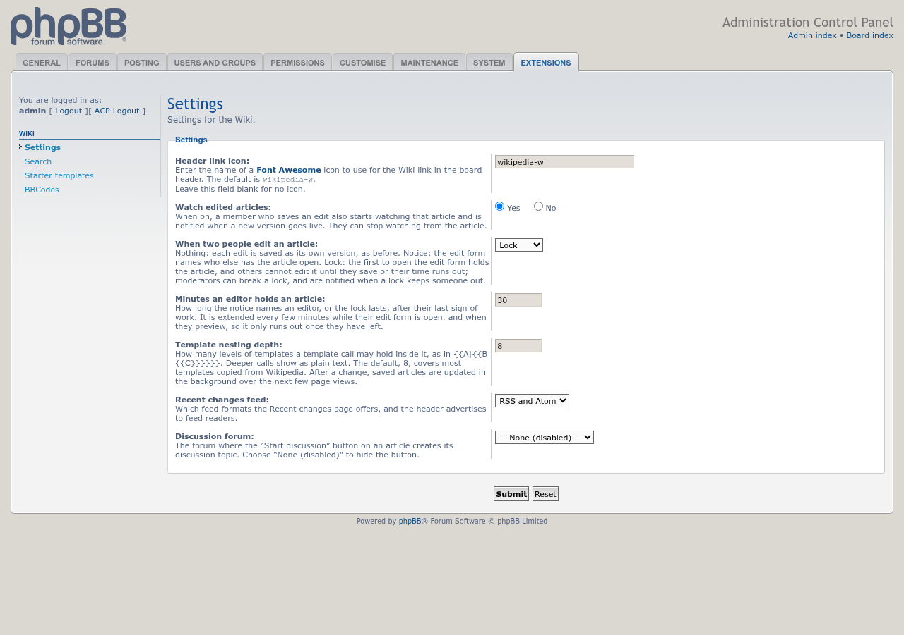

# phpBB Modders Wiki: update of 11/10/2026

Screenshot for the 11/10/2026 update of the 1.1.0-a2-dev build.

## Template nesting depth

The new Template nesting depth setting under ACP » Extensions » Wiki » Settings: how many levels of templates a template call may hold inside it. The default, 8, covers most templates copied from Wikipedia; deeper calls show as plain text.

